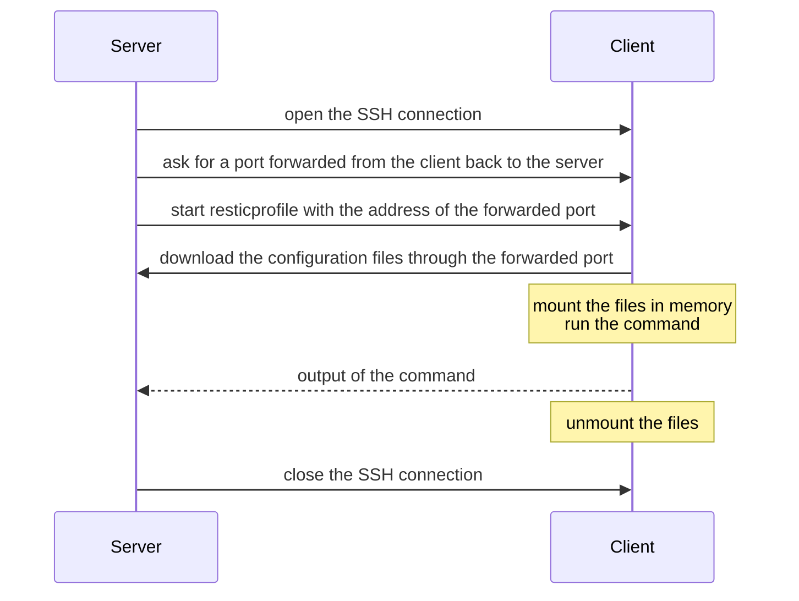

{}

The client/server mode is in preview. It has been available since `v0.33.0`.

The commands `send` and `serve` are hidden from the help and display a warning when they run. Their behaviour and their configuration may change in a future version.

{}

## Introduction

The client/server mode keeps the configuration of many machines in one place. A central machine sends a configuration to another machine over SSH and runs resticprofile there. The configuration is never written to the disk of that machine.

This page uses these two names:

| Name       | Role                                                                                              |
|------------|---------------------------------------------------------------------------------------------------|
| **server** | The machine that holds the configuration files. This is where you type `resticprofile send`.       |
| **client** | The machine to back up. It receives the configuration, then resticprofile and restic run on it.   |

{}
These names describe who owns the configuration. At the SSH level the roles are the other way round: the server opens the SSH connection, and the client must run an SSH server.
{}

## How it works



1. The server reads the definition of the remote and opens an SSH connection to the client.
2. The server asks the SSH server of the client to forward a random port of the client's loopback interface back to the server. A small HTTP server delivers the configuration files through this port.
3. The server starts resticprofile on the client, with the address of the forwarded port.
4. resticprofile on the client downloads the files as a `tar` archive: the configuration file, the additional files, and a manifest with the name of the profile and the command to run.
5. The client mounts the files as a read-only, in-memory filesystem ([FUSE](https://en.wikipedia.org/wiki/Filesystem_in_Userspace)) in a temporary directory. It changes its working directory to this directory, loads the configuration and runs the command.
6. The output of the command is displayed in the terminal of the server. When the command ends, the client unmounts the filesystem and removes the temporary directory, and the server closes the connection.

## Requirements

On the server:

- Network access to the SSH port of the client
- The `ssh` command in the `PATH`, only for the [connection type](#connection-types) `openssh`

On the client:

- An SSH server that accepts remote port forwarding: `AllowTcpForwarding` must be `yes` or `remote` in `sshd_config`
- resticprofile `v0.33.0` or later, and restic
- FUSE, usable by the user of the SSH connection:
  - Linux: the `fusermount3` command (package `fuse3` on most distributions)
  - macOS: [macFUSE](https://macfuse.github.io/)

The client side is not available on Windows, NetBSD, OpenBSD, Solaris and 32-bit Linux (`386`, `arm`, `mips`, `mipsle`). This restriction does not apply to the server.

## Configuration

The clients are declared on the server, in a `remotes` section at the top level of the configuration file. Each remote has a name, which is the name you give to the `send` command.


{}

```yaml
version: "2"

remotes:
  web1:
    connection: ssh
    host: web1.example.com
    port: 22
    username: backup
    private-keys:
      - keys/id_ed25519
    configuration-file: clients/web1.yaml
    profile-name: default
    send-files:
      - clients/common.yaml
      - secrets/password.txt
```

{}
{}

```toml
version = "2"

[remotes.web1]
  connection = "ssh"
  host = "web1.example.com"
  port = 22
  username = "backup"
  private-keys = ["keys/id_ed25519"]
  configuration-file = "clients/web1.yaml"
  profile-name = "default"
  send-files = ["clients/common.yaml", "secrets/password.txt"]
```

{}
{}

```json
{
  "version": "2",
  "remotes": {
    "web1": {
      "connection": "ssh",
      "host": "web1.example.com",
      "port": 22,
      "username": "backup",
      "private-keys": ["keys/id_ed25519"],
      "configuration-file": "clients/web1.yaml",
      "profile-name": "default",
      "send-files": ["clients/common.yaml", "secrets/password.txt"]
    }
  }
}
```

{}


| Property             | Required             | Description                                                                                                         |
|----------------------|----------------------|---------------------------------------------------------------------------------------------------------------------|
| `connection`         | yes                  | [Connection type](#connection-types): `ssh` or `openssh`                                                            |
| `host`               | yes                  | Address of the client, without the port                                                                             |
| `port`               | with `ssh`           | SSH port of the client                                                                                              |
| `username`           | with `ssh`           | User of the SSH connection                                                                                          |
| `private-keys`       | no                   | List of private key files used to authenticate                                                                      |
| `known-hosts`        | no                   | File containing the public key of the client                                                                        |
| `ssh-config`         | no                   | OpenSSH configuration file. Only used by the connection type `openssh`                                              |
| `binary-path`        | no                   | Path to resticprofile on the client. Default is `resticprofile`, which must be in the `PATH` of the SSH session     |
| `configuration-file` | yes                  | Configuration file sent to the client, and loaded by resticprofile on the client                                    |
| `profile-name`       | no                   | Profile to run on the client. Default is `default`                                                                  |
| `send-files`         | no                   | List of other files sent to the client: included configuration files, password files, ...                           |

Some details to keep in mind:

- `connection` has no default value: a remote without it fails with the error `unsupported connection type ""`.
- A relative path is relative to the directory of the main configuration file: the one selected with `--config`. This is also the case for a remote declared in an [included]({}) file.
- Environment variables are expanded in paths (`$HOME/.ssh/id_ed25519`). The `~` prefix is not expanded.
- The [JSON schema]({}) does not describe the `remotes` section yet. An editor that validates the file reports the section as not allowed.

{}
Use the [configuration `v2`]({}) for the file that declares the remotes. The section also works in the format `v1`, but `remotes` is then listed as a profile by the `profiles` command.
{}

### Connection types

| | `ssh` | `openssh` |
|---|---|---|
| Implementation | SSH client built in resticprofile | The `ssh` command installed on the server |
| `port` | Required | Optional: default is the port of your OpenSSH configuration, or `22` |
| `username` | Required | Optional |
| `private-keys` | Default is all the `id_*` private keys in `~/.ssh` | Optional: each file is passed with `-i` |
| Private key protected by a passphrase, SSH agent | Not supported | Supported |
| `known-hosts` | Default is `~/.ssh/known_hosts` | Optional: passed as `UserKnownHostsFile` |
| `ssh-config` | Ignored | Passed with `-F` |
| OpenSSH configuration (`~/.ssh/config`, `ProxyJump`, ...) | Not used | Used |

With the type `ssh`, the client must already be a known host: resticprofile never adds a host key. Connect once with the `ssh` command, or add the key yourself.

`ssh-keyscan` returns the key it receives from the network without authenticating it. Display the fingerprints of the scanned keys first:

```shell
ssh-keyscan -H web1.example.com > web1.keys
ssh-keygen -lf web1.keys
```

Compare them with the fingerprints displayed on the client itself, from its console or any other channel you trust:

```shell
for key in /etc/ssh/ssh_host_*_key.pub; do ssh-keygen -lf "$key"; done
```

Only add the keys when the fingerprints are the same:

```shell
cat web1.keys >> ~/.ssh/known_hosts
```

Still with the type `ssh`, on a Unix server, the value `/dev/null` for `known-hosts` disables the verification of the host key. Anyone able to intercept the connection can then receive your configuration files, so keep it for tests.

### Files sent to the client

The client receives the file in `configuration-file` and all the files in `send-files`. A few rules apply to these files:

- **The directories are not kept.** Every file is stored under its file name, at the root of the directory where resticprofile runs on the client. In the example above, `secrets/password.txt` becomes `password.txt`. Two files with the same name cannot be sent together.
- **The server does not read the configuration it sends.** A file that the configuration needs is only sent when it is listed in `send-files`: this includes the files of the `includes` section.
- **The configuration is loaded on the client.** [Templates]({}) and [variables]({}) are resolved there: `{{ .Hostname }}` is the name of the client.
- **The directory is read-only.** resticprofile cannot create a file in it. Use an absolute path of the client for any file written during the run, like the [lock]({}) or the [status file]({}).

Here are the two files sent with the example above. They refer to each other, and to the password file, by file name only:

```yaml
# clients/web1.yaml
version: "2"

includes:
  - common.yaml

profiles:
  default:
    use: base
    lock: /tmp/resticprofile-default.lock
    backup:
      source: /var/www
```

```yaml
# clients/common.yaml
version: "2"

mixins:
  base:
    repository: sftp:backup@storage.example.com:/backup/web1
    password-file: password.txt
    initialize: true
```

## Sending a configuration

```shell
resticprofile [resticprofile flags] send <remote> [command] [arguments...]
```

The flags before `send` apply to the server: use `--config` to select the configuration file that declares the remotes. Everything after the name of the remote is the command line to run on the client, as you would type it after `resticprofile` on the client itself:

```shell
resticprofile -c server.yaml send web1 backup
resticprofile -c server.yaml send web1 backup --tag "sent from the server" --dry-run
resticprofile -c server.yaml send web1 snapshots
resticprofile -c server.yaml send web1 profiles
```

The output of the client is displayed on the server:

```
$ resticprofile -c server.yaml send web1 backup
2026/11/14 23:06:45 send: this command is experimental and its behaviour may change in the future
2026/11/14 23:06:45 downloading file password.txt (7 bytes)
2026/11/14 23:06:45 downloading file common.yaml (120 bytes)
2026/11/14 23:06:45 downloading file web1.yaml (166 bytes)
2026/11/14 23:06:45 downloading manifest (130 bytes)
2026/11/14 23:06:45 using configuration file from manifest: "web1.yaml"
2026/11/14 23:06:45 mounting filesystem at /tmp/resticprofile-217521449
2026/11/14 23:06:45 loading: web1.yaml
2026/11/14 23:06:45 using restic 0.18.0
2026/11/14 23:06:45 profile 'default': starting 'backup'
...
processed 1 files, 6 B in 0:00
snapshot f7d7f897 saved
2026/11/14 23:06:49 profile 'default': finished 'backup'
2026/11/14 23:06:49 unmounting filesystem
```

How the command runs on the client:

- Without a command, the client runs the default command: `snapshots`, unless `default-command` is set in the `global` section of the configuration sent.
- The profile is always the one in `profile-name`. The syntax `profile.command` and the flag `--name` are not understood after the name of the remote. To run another profile, declare another remote with the same connection and a different `profile-name`.
- resticprofile always runs in verbose mode on the client, whatever the flags used on the server.
- The connection to the client must be established within 20 seconds. The client then has 2 minutes to download its files.
- `send` returns the exit code `0` when the command succeeded on the client. It returns `1` when the connection failed, or when the command failed on the client.

`send` handles one remote at a time. A shell loop sends a configuration to several clients:

```shell
for remote in web1 web2 db1; do
  resticprofile -c server.yaml send "$remote" backup || echo "backup failed on $remote"
done
```

The `schedule` command does not know about remotes. To run `send` on a schedule, add the command to the scheduler of the server yourself.

## Serving configurations

The `serve` command starts the HTTP server that delivers the configuration files, without the SSH connection:

```shell
resticprofile -c server.yaml serve 8080
```

The server listens on `localhost` only. The files of a remote are available at `/configuration/<remote>`. Stop the server with `Ctrl-C`.

A client downloads and runs its configuration with the hidden flag `--remote` (or `-r`), or with the environment variable `RESTICPROFILE_REMOTE`:

```shell
resticprofile --remote http://localhost:8080/configuration/web1
```

This mode is different from `send`:

- The connection properties of the remote are not used: only `configuration-file`, `profile-name` and `send-files` are.
- The command line of the client is ignored: the client always runs the default command of the profile.
- The flag `--name` on the client replaces `profile-name`.
- The traffic is plain HTTP, without authentication. As the server only listens on `localhost`, you have to provide the transport to the client, for example an SSH port forwarding.
- When the client cannot download or mount its files, resticprofile returns the exit code `4`.

## Security

- The files are transferred inside the SSH connection.
- The forwarded port is open on the loopback interface of the client while `send` is running, without authentication. Any user logged on the client can download the files during that time, including the password files. Do not send secrets to a client shared with users you do not trust.
- On the client, the files only exist in memory. They are erased from memory when the command ends, and they are never written to the disk.
- The host key of the client is verified. With the type `ssh`, setting `known-hosts` to `/dev/null` disables this verification.
- The `serve` command has no authentication and no encryption.

## Troubleshooting

| Message | Cause |
|---|---|
| `remote not found` | The name is not declared in the `remotes` section of the configuration file of the server. Check the `--config` flag. |
| `unsupported connection type ""` | `connection` is missing from the remote. |
| `ssh: tcpip-forward request denied by peer` (type `ssh`), `error while starting SSH tunnel` (type `openssh`) | The SSH server of the client refuses the port forwarding. Set `AllowTcpForwarding` to `yes` or `remote`. |
| `missing port in address` | `port` is missing from the remote. The type `ssh` has no default port. |
| `host key verification failed: knownhosts: key is unknown` | The client is not in the `known-hosts` file. |
| `unable to parse private key: ssh: this private key is passphrase protected` | The type `ssh` cannot use this key. Use a key without a passphrase, or the type `openssh`. |
| `no ssh key found` | None of the `private-keys` could be loaded. With the type `ssh` and no `private-keys`, no usable `id_*` key was found in `~/.ssh`. |
| `failed to mount filesystem` | FUSE is not installed on the client, or the user is not allowed to use it. |
| `another process is already running this profile` | The `lock` of the profile is a relative path: the lock file cannot be created in the read-only directory. Use an absolute path. |
